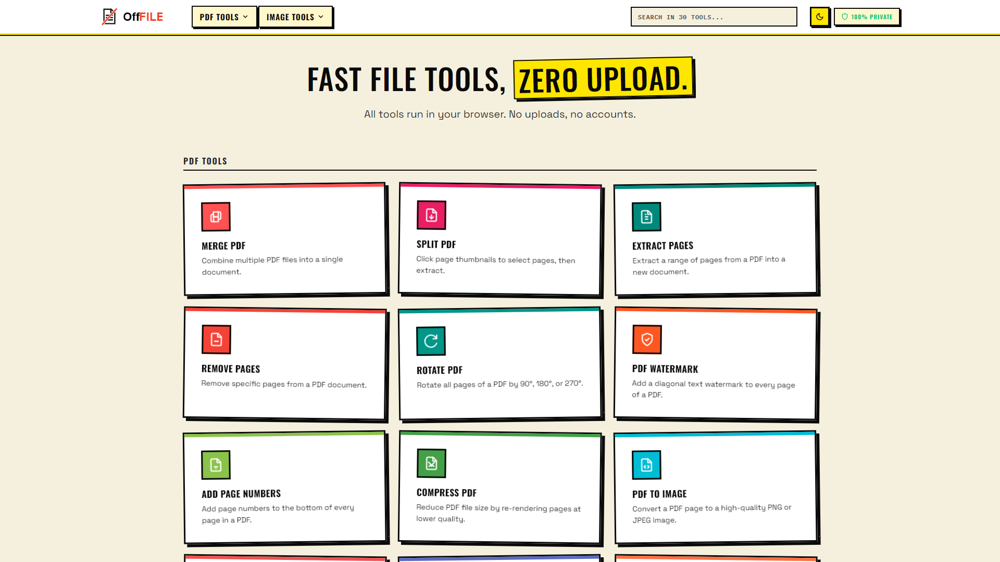
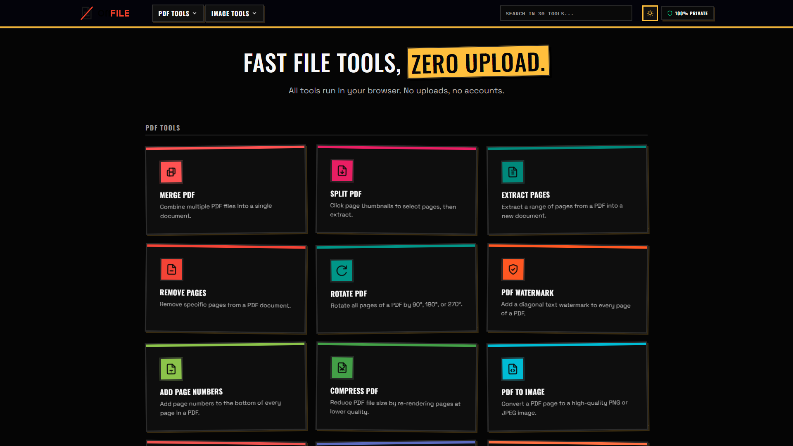
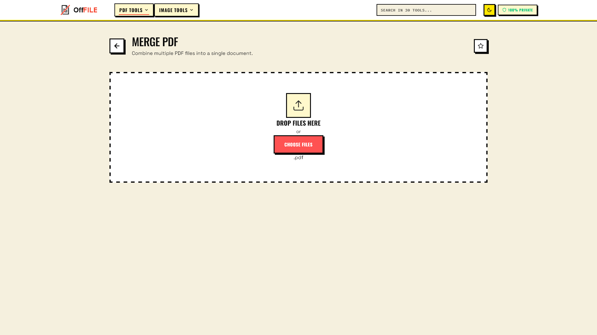

# OffFile

[](LICENSE)
[](package.json)
[](https://offfile.sametsarikaya.com)

38 file tools that run entirely in your browser. No uploads, no accounts, no server.

**[offfile.sametsarikaya.com](https://offfile.sametsarikaya.com)** - no install required.

---





---

## Why

Most online file tools send your files to a server. They have to - that's where the processing happens. OffFile does everything locally using Web Workers and browser APIs, so your files never leave your device. It works offline once loaded.

## Tools

**PDF (13)** - Merge, Split, Extract Pages, Remove Pages, Rotate, Watermark, Add Page Numbers, Compress, Metadata, Reorder Pages, Add Blank Page, Resize Pages, Unlock

**Image (14)** - Convert, Compress, Resize, Rotate, Flip, Watermark, Filters, Grayscale, Add Background, Merge/Stack, Strip Metadata, Color Palette, Crop, Collage

**Convert (11)** - PDF to Image, PDF to Text, Image to PDF, Image to Base64, SVG to PNG/JPG, Create ZIP, Extract ZIP, QR Code Generator, File Hash, Text to PDF, Favicon Generator

## Stack

- TypeScript + Vite
- pdf-lib and pdfjs-dist for PDF
- Canvas API for image processing
- Web Workers for off-main-thread processing
- Zod for option validation at the worker boundary

No frameworks. No backend.

## Running locally

```sh
npm install
npm run dev
```

Build:

```sh
npm run build
```

## Development

```sh
npm run verify        # typecheck + lint + unit tests
npm run typecheck     # tsc --noEmit
npm run lint          # ESLint
npm run format        # Prettier (write)
npm test              # Vitest unit tests
npm run test:coverage # Vitest with coverage
npm run e2e           # Playwright end-to-end tests
```

E2E tests build the app and run it against a preview server, so the first run
takes longer. Playwright needs its browser once: `npx playwright install chromium`.

CI runs typecheck, lint, format check, unit tests, a production build and the
E2E suite on every push and pull request.

## Privacy

All processing runs in the browser. No data is sent anywhere. No analytics, no cookies, no accounts.

## License

GNU Affero General Public License v3.0 (AGPLv3) - see [LICENSE](LICENSE).
